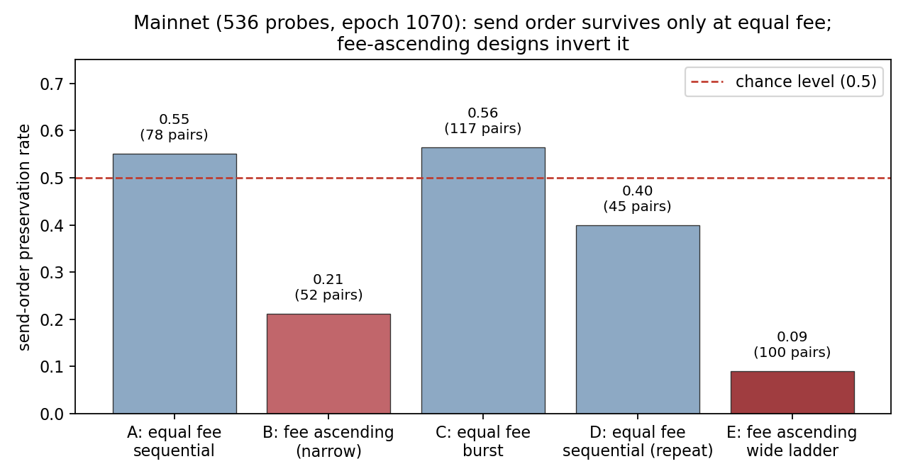
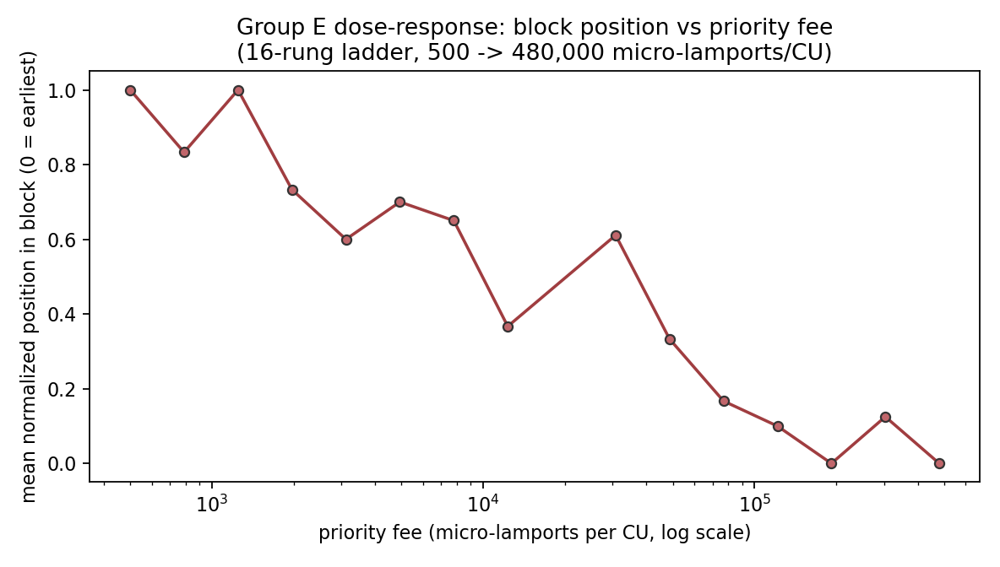
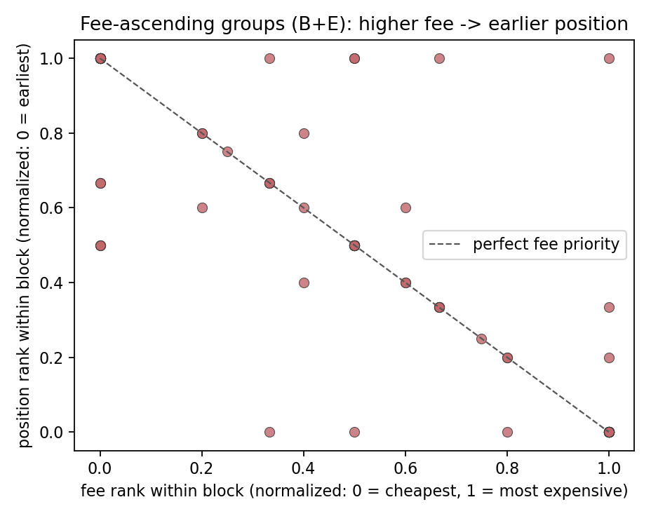

# Inside the Block — how do Solana validators order transactions?

A measurement harness for the Superteam Earn bounty *"Inside the Block: How
Solana Validators Order Transactions"*. It sends **our own** probe
transactions into leader windows and reads back, from the blocks themselves,
where they landed — then infers the ordering rule per validator.

## Results at a glance (mainnet, epoch 1070, 2026-10-28)

536 self-sent probes, four runs, 0 failures, **0.002718 SOL** total fees.
Full analysis and failure log: [REPORT.md](REPORT.md).

- **At equal priority fee, send order barely matters.** Preservation of
  send order in block position: **0.53 across 240 co-block pairs**, with
  subgroup rates straddling chance (0.40–0.56).
- **Priority fee is the lever — and it is graded.** Fee-ascending designs
  preserve send order only **0.13 of the time (20/152 pairs)**. A dedicated
  ladder design (group E: 16 probes, fees 500 → 480,000
  micro-lamports/CU) shows a monotone dose–response: mean block position
  moves from latest (1.00) at the cheapest rung to earliest (0.00) at the
  most expensive, with 9 single blocks at fee↔position Spearman exactly −1.
- **No client/version-family difference is claimed** at these sample sizes;
  the one directional signal (stronger fee effect under leaders reporting
  version 26.10.4) is flagged as small-n in the report.
- **Window targeting is hard from a residential connection** — quantified
  honestly in the report, with all probes re-attributed to their blocks'
  actual leaders via the epoch leader schedule.





## Design (why it is built this way)

**Probe shape.** Every probe is a self-transfer with an explicit
compute-unit limit (3,000) and a chosen compute-unit price (priority fee).
The transfer amount (101–408 lamports) encodes the probe's group and send
index, making every probe a distinct, on-chain-identifiable transaction
(identical amounts would collapse into identical signatures — see
REPORT.md “what went wrong” #8).
Self-transfers touch no shared state, so probes cannot reorder each other
through account locks or failed executions; the only ordering signals left
are arrival, fee, and the leader's scheduler.

**One variable per group** (8 probes each):

| Group | Variable | Question |
|---|---|---|
| A | constant fee, 150 ms send interval | does send order survive into block order? |
| B | priority fee ascending with send order | can a later, pricier tx jump the queue? |
| C | constant fee, burst (no interval) | what orders near-simultaneous arrivals? |
| D | exact repeat of A | stability / noise floor of A's answer |

**Evidence discipline.** Conclusions use only our own signatures and their
indices inside the block (`getBlock`). Other transactions are background
competition, never evidence. Every run stores the full raw record —
signature, slot, block index, send wall-clock and monotonic timestamps,
actual fee — as JSON under `data/raw/`.

**Leader windows.** `windows` mode reads the epoch leader schedule, picks
the top validators by stake, and computes each target's next 4-slot leader
window so probes can be timed into it. Fork identity (Agave / Jito /
Firedancer) is read from node version strings first and confirmed against
validators.app data on the day of measurement, because that is what the
bounty allows as identification.

**Spend safety.** A persistent ledger (`data/spend.json`) enforces a hard
cap (default **0.05 SOL**, the bounty budget): fees are *reserved* before a
transaction is built and *settled* with the actual fee afterwards; any send
that would breach the cap is refused before broadcast. **Dry-run is the
default** — live sending requires the explicit `--live` flag.

**Keys.** Only via `KEYPAIR_PATH` env / the read-only `/keys` Docker volume.
Never in the repo (see `.gitignore`).

## What this design deliberately does NOT separate

- **RPC relay queueing vs. validator-internal queueing.** From the block
  alone we cannot tell whether a reordering happened at our RPC endpoint,
  in transit (e.g. stake-weighted QoS paths), or inside the leader's
  banking stage. We mitigate by fixing one RPC path per batch and logging
  send timestamps, and we report ordering as observed *end-to-end*, not as
  a claim about any single component.
- **Jito bundles/tips.** Out of scope by the bounty's own rule; Jito
  *validators* are in scope, their bundle mechanism is not probed.
- **Sub-slot timing.** Block indices are ordinal evidence; we do not claim
  microsecond-level arrival reconstruction.

## Run it

```bash
npm install
# (Windows + recent npm only: if npm warns about blocked install scripts,
#  run `npm install-scripts approve esbuild bufferutil utf-8-validate` once)

# 1. devnet end-to-end (free): fund a throwaway keypair, then probe
KEYPAIR_PATH=./keys/devnet.json npm run faucet -- --cluster devnet
KEYPAIR_PATH=./keys/devnet.json npm run probe  -- --cluster devnet --live

# 2. mainnet dry-run (default, sends nothing): plan + cost estimate
npm run probe -- --cluster mainnet

# 3. mainnet leader windows for the top-6 validators
npm run windows -- --cluster mainnet

# 4. re-analyze a saved run
npm run analyze -- --file data/raw/run-devnet-<stamp>.json
```

Docker (the bounty's one-command reproduction path):

```bash
docker compose run --rm harness            # dry-run plan
docker compose run --rm harness npx tsx src/run.ts probe --cluster devnet --live
```

## Metrics

Per (group, slot): landed count, share of send-order pairs preserved in
block order, and Spearman correlation between priority fee and block
position. Ordering claims are only made **within a single block**; probes
that straddle slots are split by slot before analysis.

See `REPORT.md` for dated measurement rounds and the "what went wrong" log.
